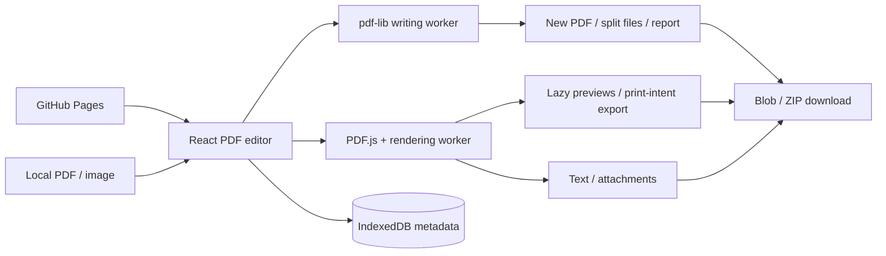

# PDF Toolkit Architecture

## Product and FE design

Audience: users organizing local documents. First screen: document queue, real lazy page previews, explicit controls/results. Green commands, neutral page surfaces, bundled fonts, Lucide icons/tooltips, compact type, responsive navigation, and reduced-motion support follow suite conventions.

## HLD

No HTTP backend, file server, OCR/model service, account, or server DB exists. The writing worker and PDF.js local APIs provide backend computation. Local workers/fonts/CMaps/WASM assets avoid runtime external resource services. Static hosting cannot supply arbitrary Office or cryptographic/forensic conversions.

## LLD

| Module | Ownership |
| --- | --- |
| `src/Workbench.tsx` | Queue/order/selection, controls, progress/cancel, results and transactional reuse |
| `src/engine.ts` | Document loading, typed mutations, ranges/bounds/forms/metadata |
| `src/worker.ts` | Mutation/split/inspection dispatch |
| `src/browser.ts` | PDF.js configuration/loading-task teardown, Blob/download |
| `src/Shell.tsx`, `src/storage.ts` | Discovery and metadata persistence |

Source: `{id,name,bytes,document}`. PDF.js proxy cleanup destroys its `loadingTask`. Failed imports release additions and keep prior sources. Image sources have no reader proxy until converted. Mutations use copied bytes, leaving originals intact.

IntersectionObserver lazily renders thumbnails at bounded scales, cancelling them on cleanup. Offscreen export uses print intent rather than display-frame scheduling and has an active cancellable render task. Worker jobs have 60-second watchdogs; navigation/unmount cancels them. Generation tokens reject stale results. Browser extraction yields between reader requests; ZIP/encoding/import do not guarantee immediate preemption.

Outputs stay separate until successful result reopen, after which previous sources are released. Merge consumes queue order; other operations use the selected document. Empty range means all pages. User indices are 1-based; internal indices are 0-based. Copy/remove/resize refuse editable forms until explicitly flattened. Page-copy fidelity limitations are documented in README.

## BE contract

`processPDF(inputs,operation,options,extra?): Promise<Uint8Array>`. `inspect(bytes): Promise<DocumentReport>`. `splitPDF(bytes,range): Promise<{name,bytes}[]>`. Worker request: `{inputs,operation,options,extra}`; response: `{bytes}`, `{files}`, `{report}`, or `{error}`.

Reader handles rendering/text/attachment extraction. The installed attachment API returns a Map and obtains bytes through `getAttachmentContent(id)` if not inline. Extraction bounds decoded size and neutralizes path separators. The UI never executes PDF scripts or embedded files. Inputs: 24/100MB; pages: 300; added attachment: 10MB; expanded attachments: 100MB; rendered page: 16MP/8192px. Writing text uses WinAnsi Helvetica.

## DB design

Database: `local-tools-PDF Toolkit`, version 1.

| Store | Key | Value | Retention |
| --- | --- | --- | --- |
| preferences | `favorites` | Tool ID array | Browser-managed |
| history | UUID | `{id,tool,name,time}` | Last 50 successful jobs |

No PDF/image bytes, names, report text, fields, metadata, attachments, or outputs persist. History insertion/pruning is transactional. Same-origin storage is not tenant isolation; migrate explicitly when schema/version changes.

## Verification and tradeoffs

Unit tests generate documents/forms and inspect order/geometry/metadata/fields. Browser tests verify actual previews, downloads, reader/writer form and attachment roundtrips, images, extraction, stale-result handling via normal navigation, and desktop/mobile accessibility/overflow. Print exports have a repeated-run regression check. This is not full PDF standards validation, cross-browser certification, or a security audit. Crop/overlays/metadata clearing are not secure redaction; rewrites may invalidate signatures. Catalog preservation and arbitrary Unicode shaping are not promised. Large parser bundles are an initial-load cost.